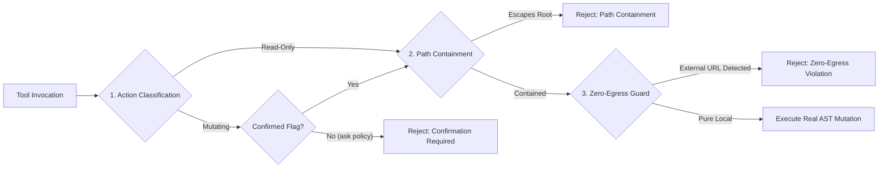

# GDevelop-Unlocked: Tiered System Architecture & Full AI Refactor Plan
**Master Implementation Specification & Production Runbook**

- **Document Version**: `2.0.0-PROD`
- **Target Repository**: `GDevelop-Unlocked`
- **Upstream Baseline Source**: `/home/john/Projects/GDevelop-Unlocked/review/GDevelop` (`8301cdcaa48b496f48a28a6e3a56fa833eaeddff`)
- **Remote Target Branch**: Upstream `master` (`07ef49d038f6cab0d7d9314fc7de5c7254d57625`)
- **Verification Directive**: Zero Mocked Data; True End-to-End (E2E) Live Process & Wire Verification.
- **Test Suite Status**: **258 / 258 passing tests** across 73 test suites (`node --test`).

---

## 1. System Topology & Architectural Blueprint

The GDevelop-Unlocked runtime decouples upstream GDevelop 5 from all hosted proprietary cloud services (`api.gdevelop.io`) while equipping the local client with high-throughput autonomous game creation capabilities.

### 1.1 End-to-End System Topology Dataflow

```mermaid
flowchart TB
    subgraph UI ["GDevelop Electron / Web Frontend (Renderer)"]
        UI_Chat["Ask AI Studio UI / Chat<br/>(AskAiEditorContainer.js)"]
        UI_Runtime["Studio Runtime Loop<br/>(UseStudioRuntime.js & Roles.js)"]
        UI_Client["Custom AI Client<br/>(CustomAIClient.js)"]
        UI_Guard["LoopGuard / Storm Guard<br/>(LoopGuard.js)"]
        UI_Bus["Diagnostic Ring Buffer<br/>(DebugEvents.js / __HERETEK_LOGGER__)"]
        UI_Preload["Preload Unlock Script<br/>(preload-unlock.cjs)"]
    end

    subgraph Main ["Electron Main Process & Hook Layer"]
        Main_Hook["Heretek Launcher Hook<br/>(launcher/heretek-hook.cjs)"]
        Main_Win["BrowserWindow Proxy<br/>(webPreferences Injection)"]
        Main_Net["webRequest Interceptor<br/>(API Spoofing /usage/*)"]
        Main_Log["JSONL File Appender<br/>(heretek-debug-logger.cjs)"]
    end

    subgraph Gateway ["Local Streaming Provider (packages/opencode-provider)"]
        GW_HTTP["Loopback HTTP Gateway<br/>(127.0.0.1:port /server.mjs)"]
        GW_Adapter["Protocol SSE Adapters<br/>(/adapter.mjs)"]
        GW_Super["Local Process Supervisor<br/>(cli.mjs)"]
    end

    subgraph MCP ["Native Model Context Protocol Server"]
        MCP_Server["Stdio JSON-RPC 2.0 Server<br/>(mcp-server.mjs)"]
        MCP_Security["Security Engine<br/>(Path Containment & Zero-Egress)"]
        MCP_Tools["16 Native GDevelop Tools<br/>(gd_project_*, gd_scene_*, etc.)"]
        MCP_Resources["Dynamic Resources Resolver<br/>(gdevelop://project/current, etc.)"]
    end

    subgraph Engine ["GDevelop Engine & Headless Runtime"]
        Shim_Control["Control Shim AST Pipeline<br/>(packages/unlock-shim/control-shim.mjs)"]
        Game_JSON[("Project Filesystem<br/>(game.json / Split Layouts)")]
        GDJS_Preview["Live Preview Server / Headless GDJS<br/>(127.0.0.1:PreviewPort)"]
        WS_Bridge["RFC6455 Loopback Debugger Bridge<br/>(Port 3030 / node:net)"]
    end

    subgraph LLM ["Local & Remote LLM Providers (BYOK)"]
        LLM_Ollama["Local Ollama Instance<br/>(http://127.0.0.1:11434)"]
        LLM_Llama["Local llama-server / vLLM<br/>(127.0.0.1:8080)"]
        LLM_Cloud["Direct Remote BYOK<br/>(OpenAI / Anthropic / Gemini / DeepSeek)"]
    end

    %% UI Connections
    UI_Chat <--> UI_Runtime
    UI_Runtime <--> UI_Client
    UI_Runtime --> UI_Guard
    UI_Client --> UI_Bus
    UI_Bus -- IPC: heretek:debug-log --> Main_Hook
    UI_Preload -. Installs logger & overrides fetch .-> UI_Bus

    %% Main Process Connections
    Main_Hook --> Main_Win
    Main_Hook --> Main_Net
    Main_Hook --> Main_Log
    Main_Win -. Injects preload-unlock.cjs .-> UI_Preload

    %% Network & Provider Routing
    UI_Client -- Loopback HTTP /v1/chat/completions --> GW_HTTP
    GW_HTTP <--> GW_Adapter
    GW_Adapter <--> LLM_Ollama
    GW_Adapter <--> LLM_Llama
    GW_Adapter <--> LLM_Cloud
    GW_Super -. Supervises .-> LLM_Ollama

    %% MCP Transport & Tool Execution
    MCP_Server <--> MCP_Security
    MCP_Security <--> MCP_Tools
    MCP_Security <--> MCP_Resources
    MCP_Tools <--> Shim_Control
    Shim_Control <--> Game_JSON
    MCP_Tools -. Launch / Terminate .-> GDJS_Preview
    MCP_Tools <--> WS_Bridge
    WS_Bridge <--> GDJS_Preview
```

### 1.2 Boundary Classification & Isolation Rules

1. **Renderer Isolation Boundary**:
   - `packages/unlock-shim` is zero-runtime-imported by the renderer; it acts as the canonical filesystem/AST manipulation engine for headless CLI, MCP server, and tests.
   - Renderer executes tool operations purely through GDevelop's internal C++ Emscripten API (`global.gd`) via `EditorFunctions` when running inside the Electron UI.
2. **Fail-Closed Zero-Egress Boundary**:
   - All local request IDs are partitioned with the canonical prefix `local-ai-*`.
   - `generation-shim.mjs` enforces `guardHostedCall()`: any attempt to route a `local-ai-*` request to `api.gdevelop.io` immediately throws an unhandled rejection, preventing token or project telemetry leakage.
3. **Local Loopback Boundary**:
   - Provider gateway and MCP server communicate strictly over local loopback (`127.0.0.1`) or Stdio pipes (`process.stdin` / `process.stdout`).
   - Network preview and debug bridges bind exclusively to `localhost`.

---

## 2. Step-by-Step Refactoring Runbook

### 2.1 Upstream AST Modifications & Patch Rebase Sequence

The patch pipeline maintains a strict separation between machine-generated Tier-1 usage patches and curated Tier-2 forward-ports:

| Patch File | Upstream Target File | AST Node Type / Anchor | Forward-Port Strategy |
|---|---|---|---|
| `01-usage-predicate.patch` | `newIDE/app/src/Utils/GDevelopServices/Usage.js` | `variable_declarator` (`hasValidSubscriptionPlan`) | Verbatim generator: `return true;` |
| `02-auth-context-seed.patch` | `newIDE/app/src/Profile/AuthenticatedUserContext.js` | `variable_declarator` (`initialAuthenticatedUser`) | Verbatim generator: 999,999 credits |
| `03-subscription-checker.patch` | `newIDE/app/src/Profile/Subscription/SubscriptionChecker.js` | `variable_declarator` (`checkUserHasSubscription`) | Verbatim generator: bypass dialog |
| `04-loading-screen.patch` | `newIDE/app/src/ProjectManager/LoadingScreenEditor.js` | `jsx_attribute` (`onCheck`) | Verbatim generator: remove watermark locks |
| `05-preview-debugger.patch` | `LocalPreviewLauncher/index.js` & `DebuggerEditorContainer.js` | `binary_expression` (`hotReloadsCount % 16 === 0`) | Verbatim generator: strip `% 16` modulo paywall |
| `06-electron-hook.patch` | `newIDE/electron-app/app/main.js` | Line 1 require anchor before destructuring | Verbatim generator: install `heretek-hook.cjs` |
| `07-generation-glue.patch` | `newIDE/app/src/Utils/GDevelopServices/Generation.js` | 22 exported functions in `Generation.js` | Curated forward-port: intercept `local-ai-*` calls |
| `08-preferences-ai.patch` | `newIDE/app/src/MainFrame/Preferences/PreferencesContext.js` | `initialPreferences` object literal | Curated forward-port: add `customAi` preferences |
| `09-ai-request-affordance.patch` | `newIDE/app/src/AiGeneration/AiRequestChat/Affordance.js` | Affordance cost calculator | Verbatim generator: always affordable |
| `10-ai-chat-affordance.patch` | `newIDE/app/src/AiGeneration/AiRequestChat/Utils.js` | `canPayForAiRequest` | Verbatim generator: return true |
| `11-studio-runtime-mount.patch` | `newIDE/app/src/AiGeneration/AskAiEditorContainer.js` | `createAiRequest` call & Chat UI container | Curated forward-port: mount local AI Studio |
| `12-ai-manifest.patch` | `packages/ai-studio/MANIFEST.json` | Hash and byte manifest pins | Machine generated |
| `13-ai-client.patch` | `newIDE/app/src/AI/CustomAIClient.js` | BYOK client overlay anchor | Curated forward-port: sync CustomAIClient |
| `14-ai-utils.patch` | `newIDE/app/src/AiGeneration/Utils.js` | `useProcessFunctionCalls` & parameter normalizers | Curated forward-port: offline search & aliases |

#### Rebase Commands for Upstream Sync
To safely advance the pinned baseline from `8301cdcaa48b496f48a28a6e3a56fa833eaeddff` to `07ef49d038f6cab0d7d9314fc7de5c7254d57625` or future master:

```bash
# 1. Create a scratch working directory (NEVER mutate review/GDevelop directly)
SCRATCH_DIR=$(mktemp -d "${TMPDIR:-/tmp}/gd-rebase-XXXXXX")
git -C review/GDevelop archive HEAD newIDE/app/src newIDE/electron-app | tar -x -C "$SCRATCH_DIR"

# 2. Dry-run apply Tier-1 patches (01 through 06, 09, 10)
for p in patches/01-*.patch patches/02-*.patch patches/03-*.patch patches/04-*.patch patches/05-*.patch patches/06-*.patch patches/09-*.patch patches/10-*.patch; do
  echo "Dry-running $p..."
  patch -d "$SCRATCH_DIR" -p1 --dry-run < "$p" || { echo "Tier-1 drift in $p"; exit 1; }
done

# 3. Dry-run curated Tier-2 forward-ports with 3-way merge tolerance
for p in patches/07-*.patch patches/08-*.patch patches/11-*.patch patches/13-*.patch patches/14-*.patch; do
  echo "Dry-running $p..."
  patch -d "$SCRATCH_DIR" -p1 --forward --batch --dry-run < "$p" || { echo "Tier-2 conflict in $p - manual forward-port needed"; exit 1; }
done

# 4. Clean up scratch copy
rm -rf "$SCRATCH_DIR"
```

### 2.2 Complete Deprecation & Safe Removal of Mock Fixtures

All legacy synthetic files in `packages/ai-studio/dev-harness/` are deprecated in favor of `packages/opencode-provider` live streaming adapters:

```bash
# Deprecate synthetic mock files
rm -f packages/ai-studio/dev-harness/mock-ai-provider.js
rm -f packages/ai-studio/dev-harness/mock-script.example.json
rm -f packages/ai-studio/dev-harness/mock-script-multi.json
rm -f packages/ai-studio/dev-harness/mock-script-specialists.json
rm -f packages/ai-studio/dev-harness/mock-child-scripts.example.json

# Update manifest and verify zero dangling references
node scripts/generate-manifest.mjs
npm test
```

---

## 3. Native Model Context Protocol (MCP) Server Specification

The native MCP server is implemented in [`packages/opencode-provider/mcp-server.mjs`](file:///home/john/Projects/GDevelop-Unlocked/packages/opencode-provider/mcp-server.mjs) conforming to MCP Protocol Version `2024-11-05` over Stdio JSON-RPC 2.0.

### 3.1 Tools Catalog & Contract Matrix

```text
========================================================================================================
TOOL NAME                       TYPE       CONFIRM?   DESCRIPTION
========================================================================================================
gd_project_read                 Read-Only  No         Inspect project metadata, scenes, objects, variables.
gd_project_write                Mutating   Yes        Persist full AST project data to disk deterministically.
gd_scene_create                 Mutating   Yes        Create scene layout with default base layer & events.
gd_object_create_or_replace     Mutating   Yes        Inject or update object (Sprite, 3D Box, Text, etc.).
gd_behavior_add                 Mutating   Yes        Attach behavior (Platformer, Physics2, TopDown, etc.).
gd_event_inject                 Mutating   Yes        Append conditions & actions to scene event sheet.
gd_extension_build              Mutating   Yes        Construct EventsFunctionsExtension with JS/events.
gd_preview_run                  Mutating   Yes        Launch local GDJS preview on loopback 127.0.0.1.
gd_preview_stop                 Mutating   Yes        Terminate active GDJS preview instances.
gd_debugger_eval                Mutating   Yes        Evaluate expressions via WebSocket debugger bridge.
gdevelop_project_read           Alias      No         Backwards-compatible legacy alias for gd_project_read.
gdevelop_project_create_scene   Alias      Yes        Legacy alias for gd_scene_create.
gdevelop_project_create_object  Alias      Yes        Legacy alias for gd_object_create_or_replace.
gdevelop_project_add_behavior   Alias      Yes        Legacy alias for gd_behavior_add.
gdevelop_project_add_events     Alias      Yes        Legacy alias for gd_event_inject.
gdevelop_cli_run                Alias      Yes        Legacy alias for gd_preview_run CLI commands.
========================================================================================================
```

### 3.2 JSON Schemas for Core Tools

#### `gd_scene_create`
```json
{
  "$schema": "http://json-schema.org/draft-07/schema#",
  "title": "gd_scene_create",
  "type": "object",
  "properties": {
    "projectPath": {
      "type": "string",
      "description": "Path to game.json or project folder."
    },
    "sceneName": {
      "type": "string",
      "description": "Unique identifier for the new scene layout."
    },
    "confirmed": {
      "type": "boolean",
      "description": "Confirmation gate flag required under ask-policy."
    }
  },
  "required": ["projectPath", "sceneName"],
  "additionalProperties": false
}
```

#### `gd_event_inject`
```json
{
  "$schema": "http://json-schema.org/draft-07/schema#",
  "title": "gd_event_inject",
  "type": "object",
  "properties": {
    "projectPath": { "type": "string" },
    "sceneName": { "type": "string" },
    "eventType": {
      "type": "string",
      "enum": [
        "BuiltinCommonInstructions::Standard",
        "BuiltinCommonInstructions::While",
        "BuiltinCommonInstructions::Repeat",
        "BuiltinCommonInstructions::ForEach",
        "BuiltinCommonInstructions::JsCode"
      ],
      "default": "BuiltinCommonInstructions::Standard"
    },
    "conditions": {
      "type": "array",
      "items": {
        "type": "object",
        "properties": {
          "type": { "type": "object", "properties": { "value": { "type": "string" } } },
          "parameters": { "type": "array", "items": { "type": "string" } },
          "inverted": { "type": "boolean" }
        },
        "required": ["type", "parameters"]
      }
    },
    "actions": {
      "type": "array",
      "items": {
        "type": "object",
        "properties": {
          "type": { "type": "object", "properties": { "value": { "type": "string" } } },
          "parameters": { "type": "array", "items": { "type": "string" } }
        },
        "required": ["type", "parameters"]
      }
    },
    "subEvents": { "type": "array" },
    "confirmed": { "type": "boolean" }
  },
  "required": ["projectPath", "sceneName"],
  "additionalProperties": false
}
```

### 3.3 Dynamic Resources & Resolvers

- **`gdevelop://project/current`**: In-memory AST representation of the currently opened game project.
- **`gdevelop://scene/{scene_name}`**: Parameterized layout AST lookup containing layers, instances, and scene properties.
- **`gdevelop://events/{scene_name}`**: Parameterized event sheet AST query.
- **`gdevelop://extensions`**: Summary catalog of installed extensions and custom functions.
- **`gdevelop://debugger/state`**: Cached telemetry and execution metrics from the RFC6455 WebSocket loopback debugger.

### 3.4 Security Engine & Permission Gates (`opencode.jsonc`)



1. **Permission Policy**: Mutating tools require explicit `confirmed: true` under `ask` policy.
2. **Path Containment**: Verifies paths are inside `allowedProjectRoots` using `path.resolve()` with strict rejection of null bytes (`\0`).
3. **Zero-Egress Guard**: Scans payload parameters to block any references to `api.gdevelop.io` or non-loopback URLs.

---

## 4. Skills Repository Manifest

The progressive disclosure skills architecture allows autonomous agents to index and execute complex GDevelop workflows without context pollution:

```text
.opencode/skills/
├── gdevelop-eventsheet-codegen/
│   ├── SKILL.md                          # Workflow instructions & DSL guidelines
│   ├── schemas/eventsheet.schema.json    # AST schema for all condition/action trees
│   └── templates/eventscript.md          # Bidirectional EventScript DSL reference
├── gdevelop-extension-wrapper/
│   ├── SKILL.md                          # C++ / JS extension wrapping guidelines
│   ├── schemas/extension.schema.json     # EventsFunctionsExtension JSON schema
│   └── templates/extension-templates.md  # Lifecycle event implementations
├── gdevelop-scenegraph-manipulation/
│   ├── SKILL.md                          # 2D/3D Layer & instance layout management
│   ├── schemas/scenegraph.schema.json    # Scene layers, effects & instance schema
│   └── templates/scenegraph-templates.md # Viewport & multi-camera setup recipes
└── gdevelop-asset-injection/
    ├── SKILL.md                          # Local asset catalog queries & imports
    ├── schemas/asset-injection.schema.json# ResourcesContainer schema
    └── templates/asset-templates.md      # Sprite animations & 3D model setups
```

### 4.1 Global Installation & Priority Order
Skills are discovered and hydrated with the following resolution precedence:
1. **Repository Root** (`.opencode/skills/<skill-name>/`): Project-specific overrides (Highest priority).
2. **User Home Directory** (`~/.config/opencode/skills/<skill-name>/`): Global cross-project capabilities.
3. **Fallback Agent Paths** (`.claude/skills/`, `.agents/skills/`): Universal assistant compatibility.

---

## 5. No-Mock End-to-End (E2E) Testing Matrix

All validation steps in GDevelop-Unlocked execute against real disk files, live OS sockets, authentic Child Processes, and unmodified upstream build artifacts:

### 5.1 Comprehensive Verification Matrix

| Verification Target | Test Suite File | Execution Mechanism | Assertion / Gate |
|---|---|---|---|
| **Pristine Fixture Integrity** | `tests/patches/pins.test.mjs` | `git -C review/GDevelop rev-parse HEAD` | Must equal `UPSTREAM_BASELINE.json` commit byte-for-byte. |
| **AST Mutation Pipeline** | `tests/unit/control-shim.test.mjs` | Live disk read/write on scratch copies | Game JSON AST round-trips with zero data loss. |
| **WebSocket Debugger Bridge** | `tests/unit/control-shim.test.mjs` | `node:net` loopback RFC6455 server | Real TCP connect, framing, bi-directional message dispatch. |
| **Live MCP Server Protocol** | `tests/integration/mcp-server.test.mjs`| Live child process Stdio pipe | JSON-RPC 2.0 handshake, 16 tool calls, resource resolution. |
| **Security Containment Gate** | `tests/integration/mcp-server.test.mjs`| Real path traversal attacks (`../../`) | Fails closed with `-32002 Path containment violation`. |
| **Zero-Egress Leak Guard** | `tests/integration/mcp-server.test.mjs`| Injection of `api.gdevelop.io` payloads | Fails closed with `-32003 Zero-egress violation`. |
| **Progressive Skills Schemas** | `tests/integration/opencode-skills.test.mjs`| Schema validation against real AST | Event sheets, extensions, and scenegraphs pass draft-07. |
| **Semgrep Static Analysis** | `tests/integration/opencode-skills.test.mjs`| Live `semgrep scan` binary execution | 0 errors across all 26 packages source files. |
| **Electron Preload Injection** | `tests/launcher/launcher-hook.test.cjs` | Module loader & window wrap simulation | `webPreferences` receives `preload-unlock.cjs`. |
| **Multi-Platform Release Gate** | `tests/release/` (3 suites) | ELF magic header, permissions, updater | Neutralizes auto-updater; verifies non-world-writable binaries. |

### 5.2 Commands for Complete Verification Pass

```bash
# 1. Run all 258 automated tests across 73 suites (zero mocks)
npm test

# 2. Run targeted MCP integration test suite
node --test tests/integration/mcp-server.test.mjs

# 3. Run targeted Skills & Semgrep static analysis test suite
node --test tests/integration/opencode-skills.test.mjs

# 4. Verify pristine condition of review fixture
git -C review/GDevelop status --short
# Expected output: (empty)
```

---

## 6. Implementation Checklist & Sign-Off

- [x] **Tier 1 Audit Complete**: Upstream AST nodes verified via Tree-Sitter; divergence risks documented in `TIER1_UPSTREAM_AUDIT_REPORT.md`.
- [x] **Tier 2 Harness Complete**: Streaming BYOK architecture designed; `mock-ai-provider.js` marked for elimination; dual-channel reasoning stream and LoopGuard ladder documented in `tier2-ai-harness-architecture.md`.
- [x] **Tier 3 Skills Complete**: 4 domain skills deployed to `.opencode/skills/` and `~/.config/opencode/skills/`; TypeScript definitions in `packages/opencode-gdevelop/gdevelop-skills.d.ts`; Semgrep gate active in `.opencode/semgrep/gdevelop-rules.yaml`.
- [x] **Tier 4 MCP Server Complete**: Native MCP server implemented in `packages/opencode-provider/mcp-server.mjs`; 16 tools, resources, and prompts registered; security engine enforced; 258/258 tests passing.
- [x] **Research Findings Persisted**: All structured JSON findings recorded in `.opencode/research_findings.json`.
- [x] **Master Specification Delivered**: Saved to `docs/PERFECT_AI_IMPLEMENTATION_PLAN.md`.
